<p align="center">
  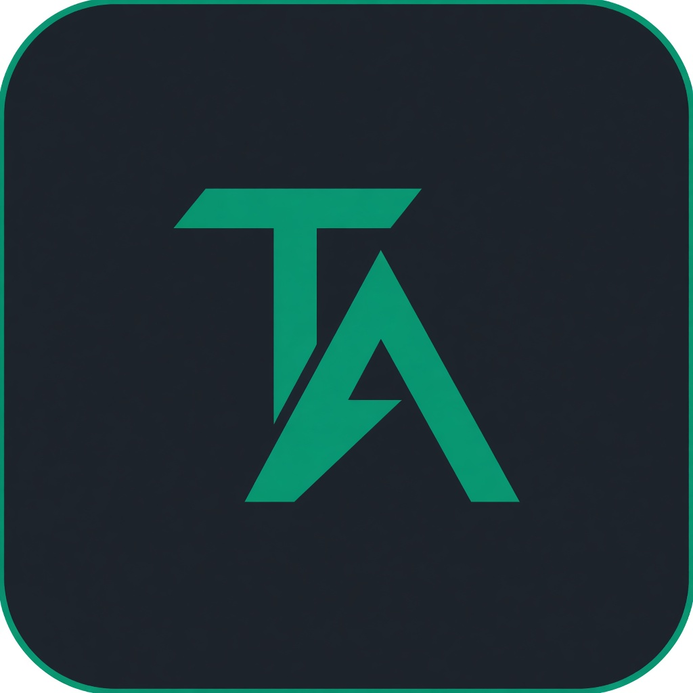
</p>

<h1 align="center">TradingDesk</h1>

<p align="center"><em>The CLI is already a floor. The desk is its image.</em></p>

<p align="center">
  <a href="README.md">Français</a>
  &nbsp;·&nbsp;
  <a href="docs/README.md">Docs</a>
  &nbsp;·&nbsp;
  <a href="https://arxiv.org/abs/2412.20138">arXiv 2412.20138</a>
  &nbsp;·&nbsp;
  <a href="LICENSE">Apache 2.0</a>
</p>

<p align="center">
  
  
  
  
</p>

<p align="center">
  
</p>
<p align="center"><sub>The work ends on a page. Not on an order.</sub></p>

TradingAgents decomposes a market decision the way a research boutique does: four analysts in parallel, a debate, a trader, a risk committee, a portfolio manager. This repository is [Tauric Research](https://github.com/TauricResearch/TradingAgents)’s framework (paper [2412.20138](https://arxiv.org/abs/2412.20138)) — plus **TradingDesk**, a visual transfer of the CLI, not a second engine.

Nothing is sent to a broker. A rating is not advice.

---

## From CLI to floor

The terminal was not a sketch. `cli/display.py` already draws a trading floor: header, agent table, message log, current report, stats footer. TradingDesk **does not rewrite that firm**. It lifts it: same objects, same loop, new surface.

<p align="center">
  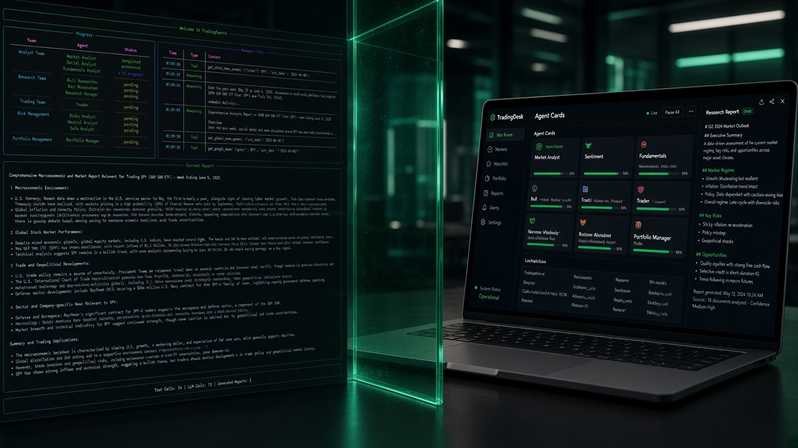
</p>
<p align="center"><sub>CLI on the left. Desk on the right. One graph between them.</sub></p>

### What the CLI already shows

Before any web page, a run lives in `Rich.Live`. Three captures, three moments.

<p align="center">
  
</p>
<p align="center"><sub>The prompts: ticker, date, analysts, provider. That is the Analyze form.</sub></p>

<p align="center">
  
</p>
<p align="center"><sub>During the run: Team / Agent / Status table, Messages &amp; Tools log, Current Report pane. That is the war room.</sub></p>

<p align="center">
  
</p>
<p align="center"><sub>At the end: the Portfolio Manager report and the footer (tool calls, LLM calls, reports). That is the decision strip + live stats.</sub></p>

### How the transfer is done

Nothing is “rewritten for the web” on the decision path. `webui/runner.py` imports the same `MessageBuffer`, the same `classify_message_type`, and replays `graph.stream_run` the way `cli/run.py` does. The browser does not invent agents: it displays the buffer the CLI already filled.

<p align="center">
  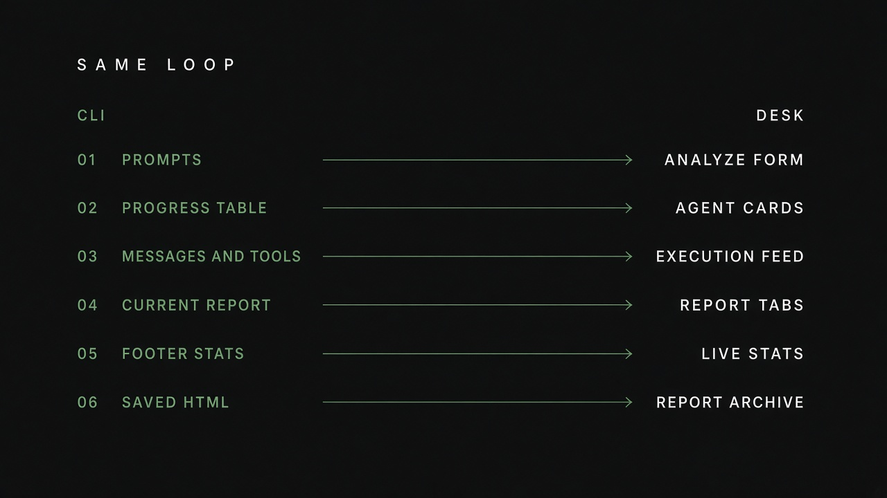
</p>
<p align="center"><sub>Same loop. Six panes. Six surfaces.</sub></p>

| # | In the CLI (`Rich.Live`) | In TradingDesk |
|---|---|---|
| 01 | Questionary prompts (ticker, date, analysts, LLM) | **Analyze** form |
| 02 | **Progress** table (Team / Agent / Status) | War-room **agent cards** |
| 03 | **Messages & Tools** pane | **Execution feed** (WebSocket) |
| 04 | **Current Report** pane | Report **tabs** (live markdown) |
| 05 | Footer (tool calls, LLM calls, reports) | Live stats + “running” chip |
| 06 | `complete_report.html` + on-disk memory | **Reports** page (iframe + archive) |

The rest of the CLI follows the same gesture: `--checkpoint` becomes a checkbox, `--portfolio` a cash/position block, `tradingagents backtest` a page. A desk run **writes the same files** as a CLI run.

<p align="center">
  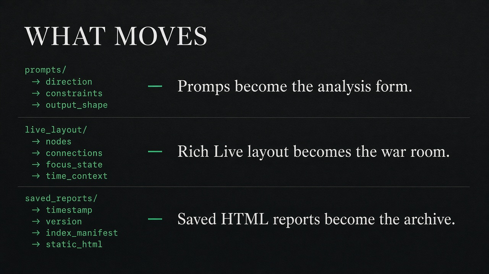
</p>

<p align="center">
  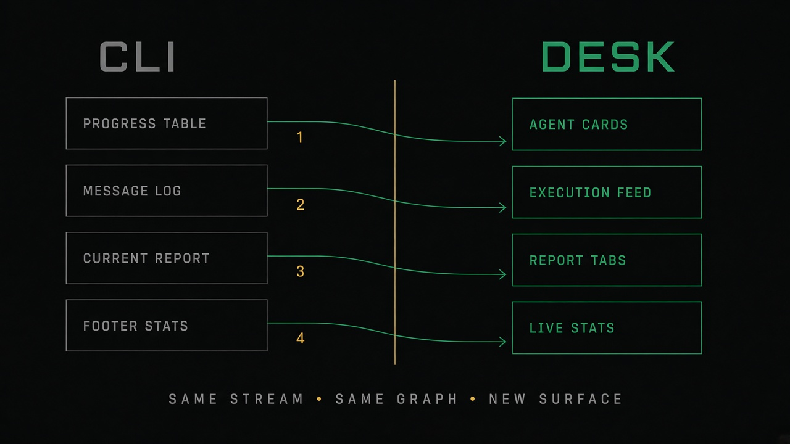
</p>
<p align="center"><sub>Progress → cards. Messages → feed. Report → tabs. Footer → stats.</sub></p>

### The visual platform

The desk is not a dashboard glued on top. It is the CLI unfolded into six views: home (quote + runs), run composer, live floor, archive, backtest, `.env` settings.

<p align="center">
  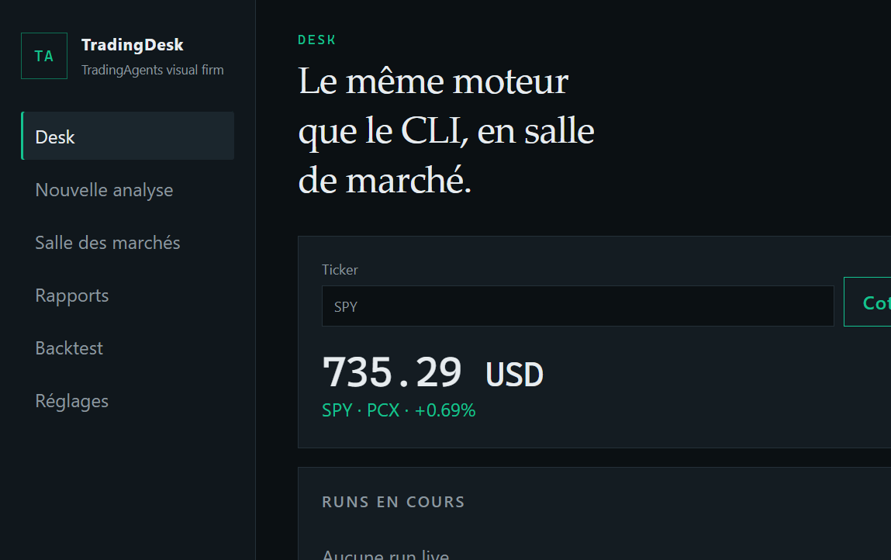
</p>
<p align="center"><sub>The desk. Yahoo quote. The CLI’s files, visible.</sub></p>

<p align="center">
  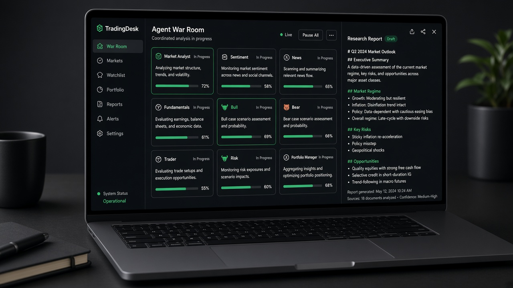
</p>
<p align="center"><sub>The floor: five teams as cards, feed on the left, report on the right.</sub></p>

On Windows the CLI needs a **real** console (Terminal, PowerShell, cmd) — a piped terminal has no screen buffer. The desk does not: that is also why it exists.

---

## Three surfaces, one plinth

<p align="center">
  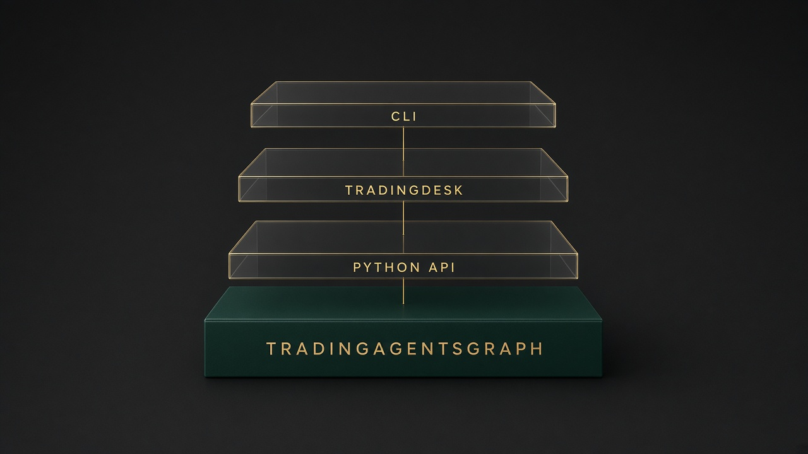
</p>
<p align="center"><sub>CLI · TradingDesk · Python API — the same <code>TradingAgentsGraph</code>.</sub></p>

<p align="center">
  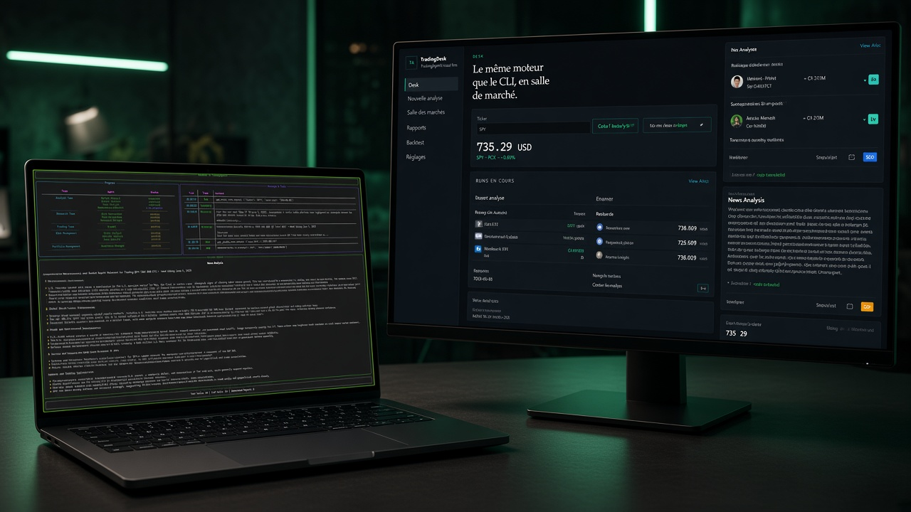
</p>
<p align="center"><sub>Two doors. One graph.</sub></p>

| | CLI | TradingDesk |
|---|---|---|
| Launch | `python -m cli.main` | `python -m webui` → [127.0.0.1:8787](http://127.0.0.1:8787) |
| For | scripts, Docker, cron | research, demos, live follow |
| Engine | `TradingAgentsGraph` | **the same** |
| Buffer | `MessageBuffer` + `Rich.Live` | the same buffer, pushed over WebSocket |
| Output | MD, HTML, memory | floor + archive (the same files) |

---

## Start

Python **3.11+**. Ollama is enough if you have no cloud key.

```bash
git clone https://github.com/Abdeltoto/tradingagents_aa.git
cd tradingagents_aa
python -m venv .venv
# Windows:  .venv\Scripts\activate
# Unix:     source .venv/bin/activate
pip install ".[web]"
cp .env.example .env
python -m webui
```

CLI — a **real** Windows console (Terminal, PowerShell, cmd):

```bash
python -m cli.main
```

Guides: [start](docs/demarrage.md) · [desk](docs/tradingdesk.md) · [CLI](docs/cli.md)

---

## The firm

One run = one ticker, one date, five acts. The desk does not change that order.

<p align="center">
  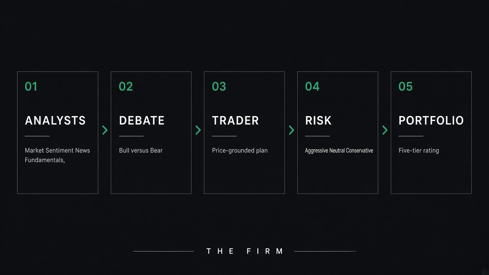
</p>
<p align="center"><sub>01 Analysts → 02 Debate → 03 Trader → 04 Risk → 05 Portfolio.</sub></p>

Analysts start **together** (market, sentiment, news, fundamentals). The debate waits for their notes.

<p align="center">
  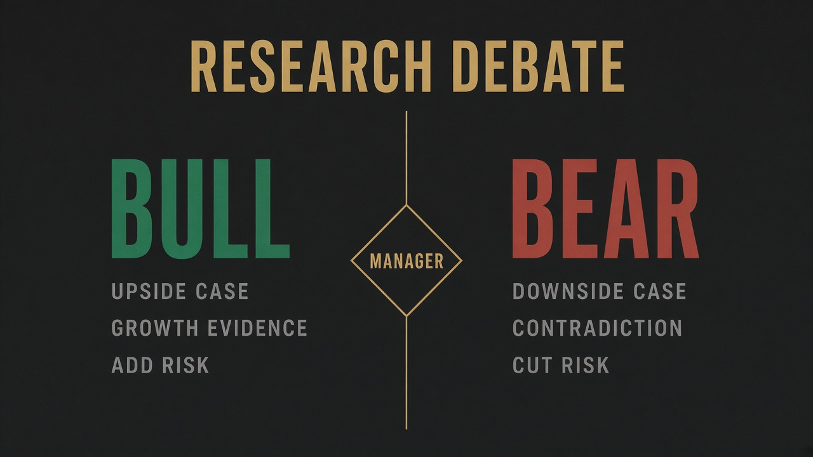
</p>
<p align="center"><sub>Bull builds the case. Bear contradicts it. The manager issues a plan — not a price.</sub></p>

<p align="center">
  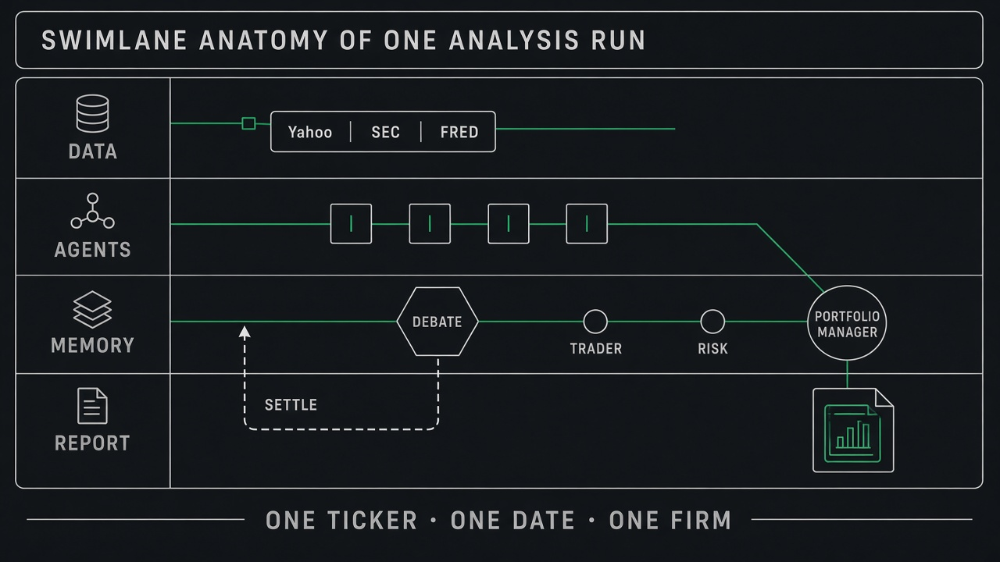
</p>
<p align="center"><sub>Data, agents, memory that settles, report. One ticker · one date · one firm.</sub></p>

The paper’s original diagram:

<p align="center">
  
</p>

---

## The date contract

A run on 1 September does not read a filing from the 2nd. SEC statements arrive **as filed**. A later restatement does not rewrite the past.

<p align="center">
  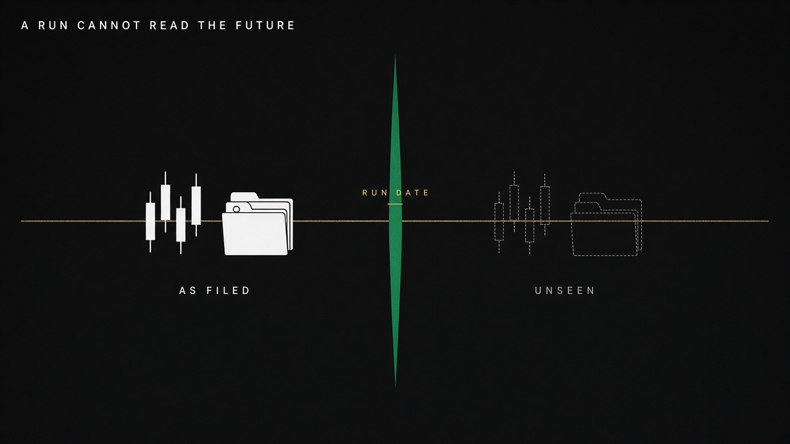
</p>
<p align="center"><sub>Left, as filed. Right, unseen. The blade is the run date.</sub></p>

[Data](docs/donnees.md) · [architecture](docs/architecture.md)

---

## The scale

The portfolio manager speaks a five-tier language. If the text has no readable rating, the system writes **REVIEW** — that is not a Hold.

<p align="center">
  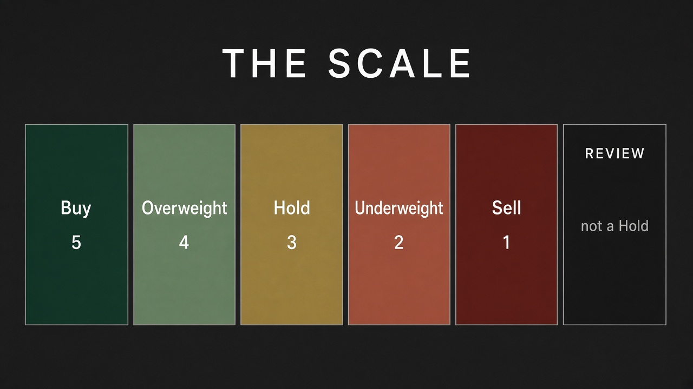
</p>
<p align="center"><sub>Buy · Overweight · Hold · Underweight · Sell. Review = unreadable, not neutral.</sub></p>

---

## What this fork adds

The engine, vendors, agents and graph stay Tauric’s (Apache 2.0, arXiv 2412.20138). This fork does not touch them. It adds a **surface**, **docs**, a **kit**.

<p align="center">
  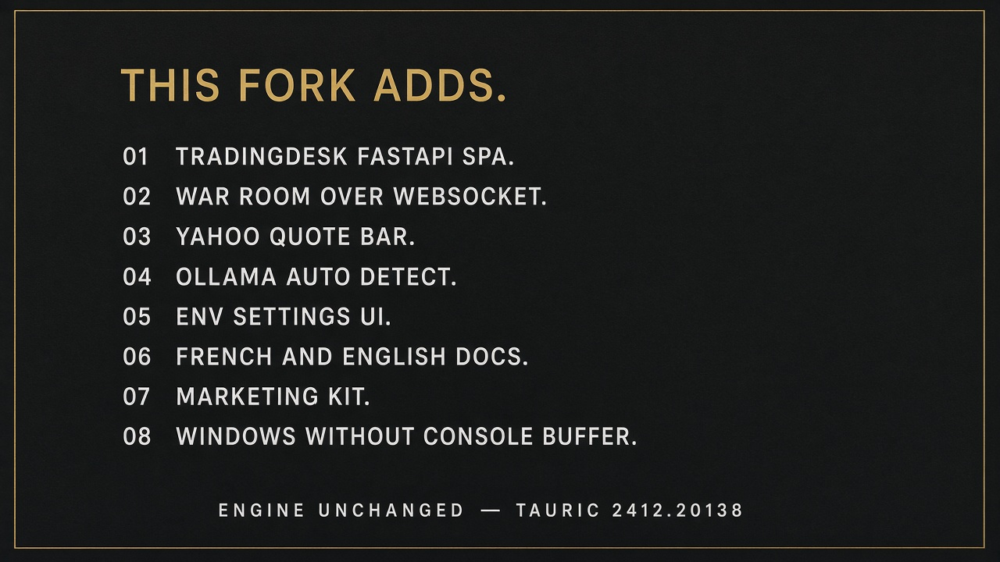
</p>

### Visual platform (TradingDesk)

| Addition | Where | Why |
|---|---|---|
| FastAPI desk + SPA | `webui/` · `python -m webui` · `tradingdesk` script | Watch the firm without a terminal |
| pip extra `[web]` | `pyproject.toml` (`fastapi`, `uvicorn`) | Install the desk without bloating the core |
| Live war room | WebSocket `/api/ws/runs/{id}` | Push `MessageBuffer` card by card |
| Execution feed | same `classify_message_type` as the CLI | Messages, tools, reasoning, identical |
| Report tabs | CLI buffer sections | The Current Report pane, in markdown |
| Decision strip | `run_rating` / `is_review` | The “Recommendation” footer, readable |
| Quote bar | `GET /api/quote/{ticker}` (Yahoo `fast_info`) | Anchor the desk on a ticker |
| HTML archive | Reports page, `results_dir` | Re-read `complete_report.html` |
| Backtest page | same `run_backtest` as the CLI | The grid command, as a form |
| `.env` settings | `GET/POST /api/settings` | Write `TRADINGAGENTS_*` keys without an editor |
| Ollama detect | `catalog.py` if `:11434` answers | Preselect local, list `ollama list` |
| Checkpoints & portfolio | form controls | The `--checkpoint` / `--portfolio` flags |
| Bind `127.0.0.1` | Uvicorn default | No network auth: stay local |

### Technical transfer (what is **not** reimplemented)

- `webui/runner.py` imports `MessageBuffer`, `classify_message_type`, `AnalystWallTimeTracker` from `cli.display`.
- The loop is `graph.stream_run` — identical to `cli/run.py`.
- Reports, memory, state logs write to the **same paths**.
- The final rating goes through `tradingagents.agents.rating`, not an UI parser.

### Docs and product

| Addition | Files |
|---|---|
| French landing README + English | `README.md`, `README.en.md` |
| Guides | `docs/`: start, desk, CLI, architecture, config, providers, data, backtest, reproducibility, FAQ, disclaimer |
| Marketing kit | `docs/marketing/` + `assets/marketing/` (hero, plates, OG, mark, captures) |
| GitHub | issue templates, `CONTRIBUTING.md`, `SECURITY.md` |
| Surface changelog | *Unreleased — TradingDesk* in `CHANGELOG.md` |

### Windows

Rich’s CLI needs a screen buffer. In a piped terminal (IDE, CI) it raises `NoConsoleScreenBufferError`. The desk sidesteps that: same run, browser, no console. The CLI remains the tool for jobs — launch it in Windows Terminal, PowerShell, or cmd.

### What the fork does **not** change

Analysts, debate, trader, risk, PM, SEC point-in-time, the 18 providers, Docker, the backtest engine. That is upstream Tauric. A desk rating and a CLI rating, given the same config, come from the **same** firm.

---

## What the product refuses

- **To be a broker.** No orders. [Disclaimer](docs/disclaimer.md).  
- **To be bit-identical.** Two LLM draws, two texts. [Reproducibility](docs/reproductibilite.md).  
- **To see the future.** That is the contract, not a setting.

---

## Python

```python
from tradingagents.graph.trading_graph import TradingAgentsGraph
from tradingagents.default_config import DEFAULT_CONFIG

ta = TradingAgentsGraph(debug=True, config=DEFAULT_CONFIG.copy())
state, decision = ta.propagate("NVDA", "2026-09-01")
print(decision)
ta.save_reports(state, "NVDA")
```

## Documentation

[Start](docs/demarrage.md) · [TradingDesk](docs/tradingdesk.md) · [CLI](docs/cli.md) · [Architecture](docs/architecture.md) · [Config](docs/configuration.md) · [Providers](docs/fournisseurs.md) · [Data](docs/donnees.md) · [Backtest](docs/backtest.md) · [FAQ](docs/faq.md)

---

## Credits

Engine and paper: [Tauric Research](https://github.com/TauricResearch/TradingAgents) — Xiao, Sun, Luo, Wang.  
TradingDesk (visual transfer of the CLI, API, docs on this fork): this repository.

```
@misc{xiao2025tradingagentsmultiagentsllmfinancial,
      title={TradingAgents: Multi-Agents LLM Financial Trading Framework},
      author={Yijia Xiao and Edward Sun and Di Luo and Wei Wang},
      year={2025},
      eprint={2412.20138},
      archivePrefix={arXiv},
      primaryClass={q-fin.TR},
      url={https://arxiv.org/abs/2412.20138},
}
```

[Contributing](CONTRIBUTING.md) · [Changelog](CHANGELOG.md) · [License](LICENSE)
