<p align="center">
  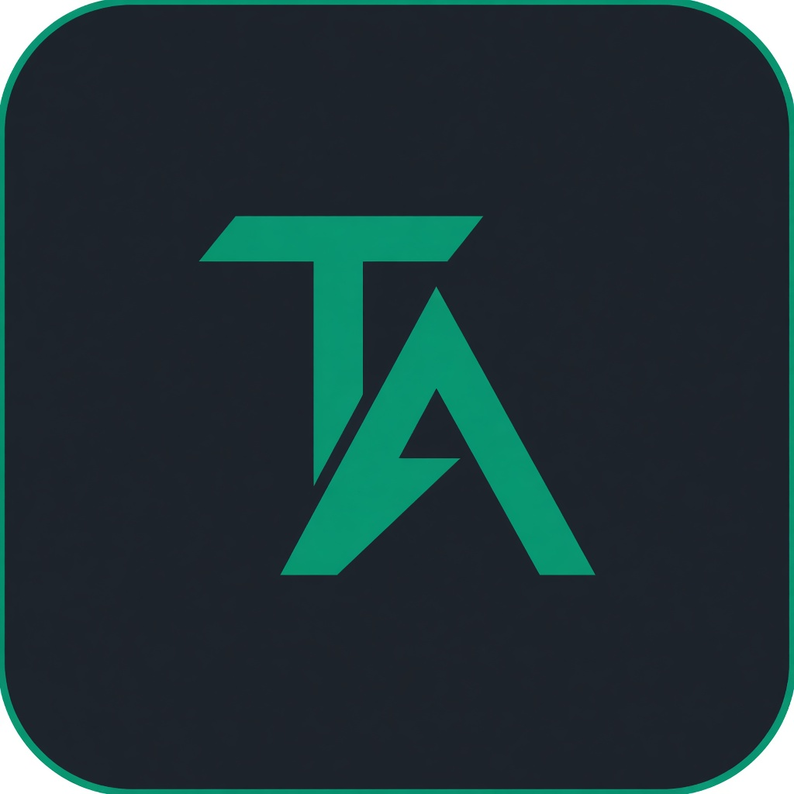
</p>

<h1 align="center">TradingDesk</h1>

<p align="center"><em>Le CLI est déjà une salle. Le desk en est l’image.</em></p>

<p align="center">
  <a href="README.en.md">English</a>
  &nbsp;·&nbsp;
  <a href="docs/README.md">Documentation</a>
  &nbsp;·&nbsp;
  <a href="https://arxiv.org/abs/2412.20138">arXiv 2412.20138</a>
  &nbsp;·&nbsp;
  <a href="LICENSE">Apache 2.0</a>
</p>

<p align="center">
  
  
  
  
</p>

<p align="center">
  
</p>
<p align="center"><sub>Le travail se termine sur une page. Pas sur un ordre.</sub></p>

TradingAgents décompose une décision de marché comme une boutique de recherche : quatre analystes en parallèle, un débat, un trader, un comité de risque, un portfolio manager. Ce dépôt est le framework de [Tauric Research](https://github.com/TauricResearch/TradingAgents) (papier [2412.20138](https://arxiv.org/abs/2412.20138)) — plus **TradingDesk**, le transfert visuel du CLI, pas un second moteur.

Rien n’est envoyé à un courtier. Un rating n’est pas un conseil.

---

## Du CLI à la salle

Le terminal n’était pas un brouillon. `cli/display.py` dessine déjà une salle de marché : en-tête, table d’agents, journal des messages, rapport courant, pied de stats. TradingDesk **ne réécrit pas cette firme**. Il la lève : mêmes objets, même boucle, autre surface.

<p align="center">
  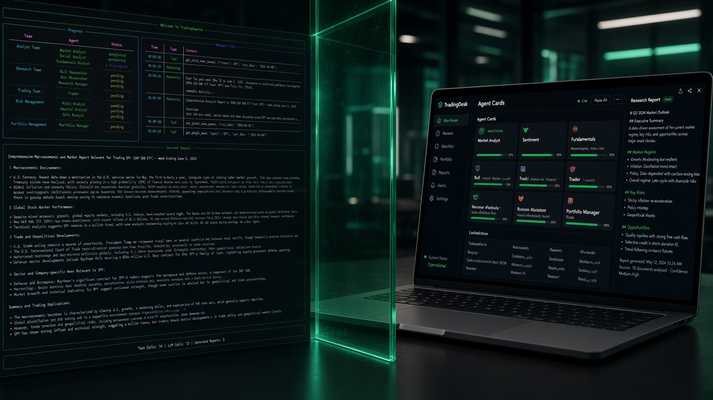
</p>
<p align="center"><sub>Le CLI à gauche. Le desk à droite. Un seul graphe entre les deux.</sub></p>

### Ce que le CLI montre déjà

Avant toute page web, la run tient dans un `Rich.Live`. Trois captures, trois moments.

<p align="center">
  
</p>
<p align="center"><sub>Les prompts : ticker, date, analystes, fournisseur. C’est le formulaire « Nouvelle analyse ».</sub></p>

<p align="center">
  
</p>
<p align="center"><sub>Pendant la run : table Team / Agent / Status, journal Messages &amp; Tools, panneau Current Report. C’est la salle des marchés.</sub></p>

<p align="center">
  
</p>
<p align="center"><sub>En fin de run : le rapport du Portfolio Manager et le footer (tool calls, LLM calls, reports). C’est la bandeau de décision + les stats live.</sub></p>

### Comment le transfert est fait

Rien n’est « recodé pour le web » côté décision. `webui/runner.py` importe le même `MessageBuffer`, le même `classify_message_type`, et rejoue `graph.stream_run` comme `cli/run.py`. Le navigateur n’invente pas d’agents : il affiche le tampon que le CLI remplissait déjà.

<p align="center">
  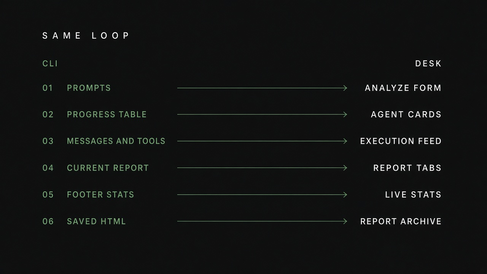
</p>
<p align="center"><sub>Même boucle. Six panneaux. Six surfaces.</sub></p>

| # | Dans le CLI (`Rich.Live`) | Dans TradingDesk |
|---|---|---|
| 01 | Prompts questionary (ticker, date, analystes, LLM) | Formulaire **Nouvelle analyse** |
| 02 | Table **Progress** (Team / Agent / Status) | Cartes d’agents de la **salle des marchés** |
| 03 | Panneau **Messages & Tools** | **Fil d’exécution** (WebSocket) |
| 04 | Panneau **Current Report** | Onglets de rapports (markdown live) |
| 05 | Footer (tool calls, LLM calls, reports) | Stats live + chip « En cours » |
| 06 | `complete_report.html` + mémoire disque | Page **Rapports** (iframe + archive) |

Le reste du CLI suit le même geste : `--checkpoint` devient une case, `--portfolio` un bloc cash/position, `tradingagents backtest` une page. Une run desk **écrit les mêmes fichiers** qu’une run CLI.

<p align="center">
  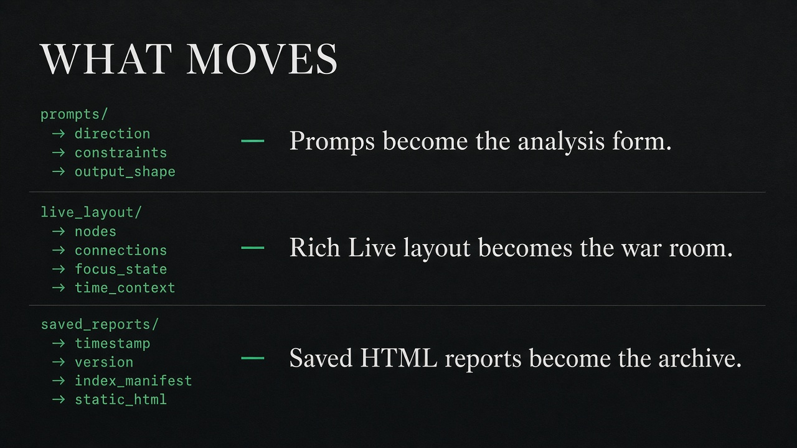
</p>

<p align="center">
  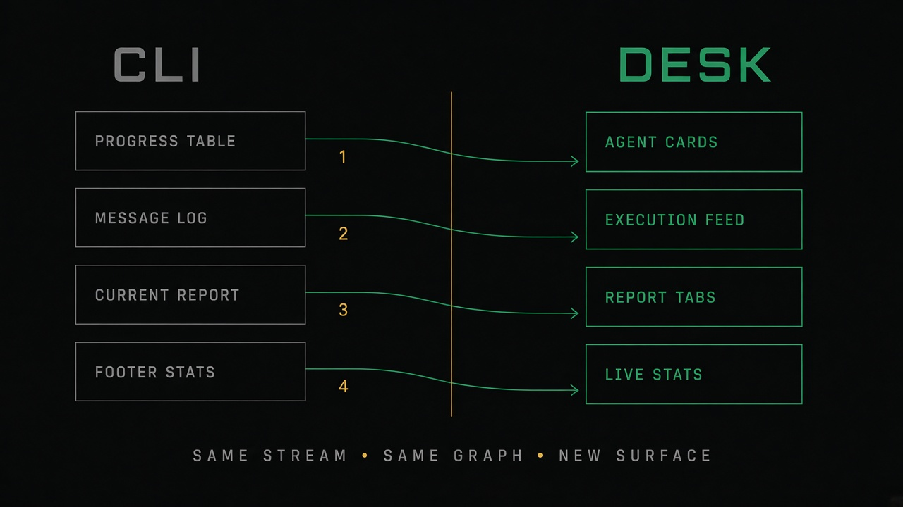
</p>
<p align="center"><sub>Progress → cartes. Messages → fil. Report → onglets. Footer → stats.</sub></p>

### La plateforme visuelle

Le desk n’est pas un dashboard collé par-dessus. C’est le CLI déplié en six vues : accueil (cotation + runs), composition de run, salle live, archive, backtest, réglages `.env`.

<p align="center">
  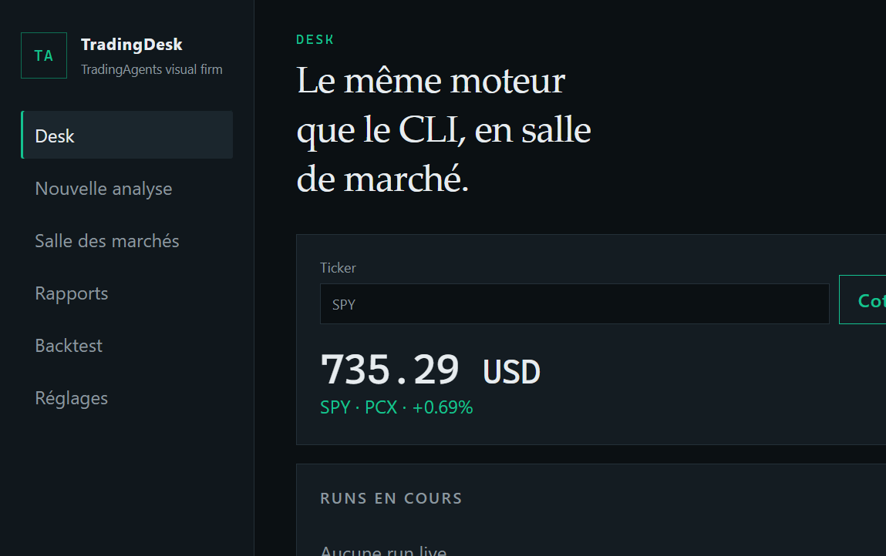
</p>
<p align="center"><sub>Le desk. Cotation Yahoo. Les mêmes fichiers que le CLI, visibles.</sub></p>

<p align="center">
  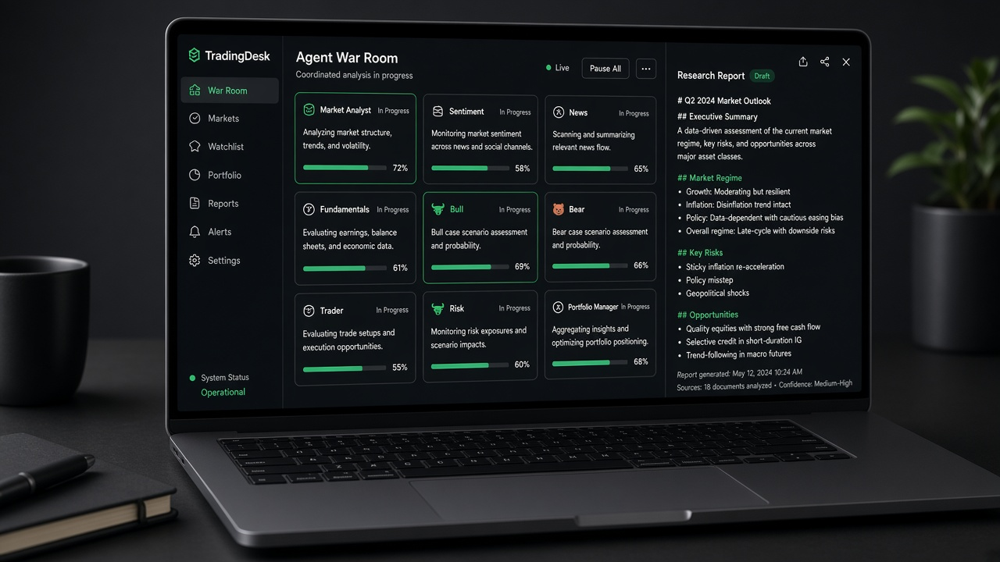
</p>
<p align="center"><sub>La salle : cinq équipes en cartes, fil à gauche, rapport à droite.</sub></p>

Sur Windows, le CLI exige une **vraie** console (Terminal, PowerShell, cmd) — un terminal pipé n’a pas de screen buffer. Le desk n’a pas ce contrainte : c’est aussi pour ça qu’il existe.

---

## Trois surfaces, un socle

<p align="center">
  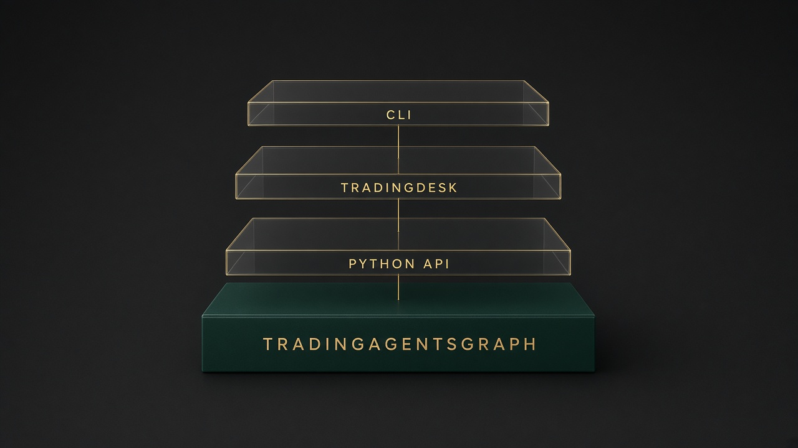
</p>
<p align="center"><sub>CLI · TradingDesk · API Python — le même <code>TradingAgentsGraph</code>.</sub></p>

<p align="center">
  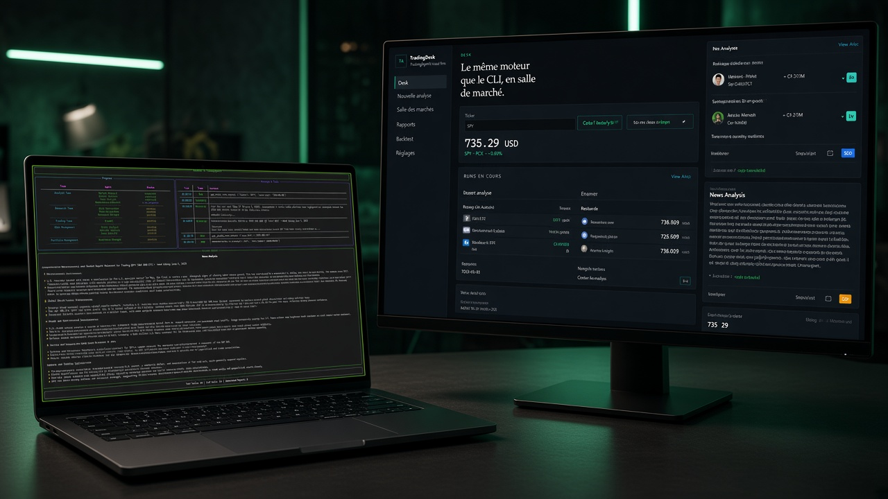
</p>
<p align="center"><sub>Deux portes. Un graphe.</sub></p>

| | CLI | TradingDesk |
|---|---|---|
| Lancer | `python -m cli.main` | `python -m webui` → [127.0.0.1:8787](http://127.0.0.1:8787) |
| Usage | scripts, Docker, cron | recherche, démo, suivi live |
| Moteur | `TradingAgentsGraph` | **identique** |
| Tampon | `MessageBuffer` + `Rich.Live` | le même tampon, poussé en WebSocket |
| Sortie | MD, HTML, mémoire | salle + archive (mêmes fichiers) |

---

## Démarrer

Python **3.11+**. Ollama suffit s’il n’y a pas de clé cloud.

```bash
git clone https://github.com/Abdeltoto/tradingagents_aa.git
cd tradingagents_aa
python -m venv .venv
# Windows:  .venv\Scripts\activate
# Unix:     source .venv/bin/activate
pip install ".[web]"
cp .env.example .env
python -m webui
```

CLI — **vraie** console Windows (Terminal, PowerShell, cmd) :

```bash
python -m cli.main
```

Guides : [démarrage](docs/demarrage.md) · [desk](docs/tradingdesk.md) · [CLI](docs/cli.md)

---

## La firme

Une run = un ticker, une date, cinq actes. Le desk ne change pas cet ordre.

<p align="center">
  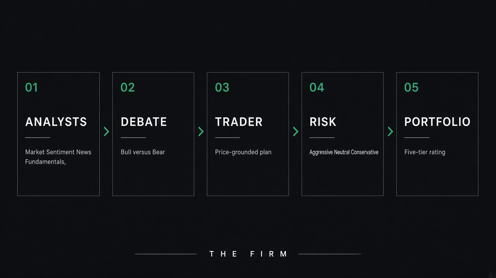
</p>
<p align="center"><sub>01 Analystes → 02 Débat → 03 Trader → 04 Risque → 05 Portfolio.</sub></p>

Les analystes partent **ensemble** (marché, sentiment, news, fondamentaux). Le débat n’ouvre qu’une fois leurs notes déposées.

<p align="center">
  
</p>
<p align="center"><sub>Bull construit le cas. Bear le contredit. Le manager tranche un plan — pas un cours.</sub></p>

<p align="center">
  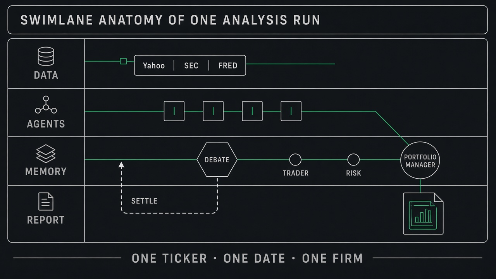
</p>
<p align="center"><sub>Données, agents, mémoire qui se règle, rapport. Un ticker · une date · une firme.</sub></p>

Le schéma du papier, pour ceux qui viennent de l’article :

<p align="center">
  
</p>

---

## Le contrat de date

Un run au 1<sup>er</sup> septembre ne lit pas un filing du 2. Les comptes SEC arrivent **tels que déposés**. Une restatement plus tardive ne réécrit pas le passé.

<p align="center">
  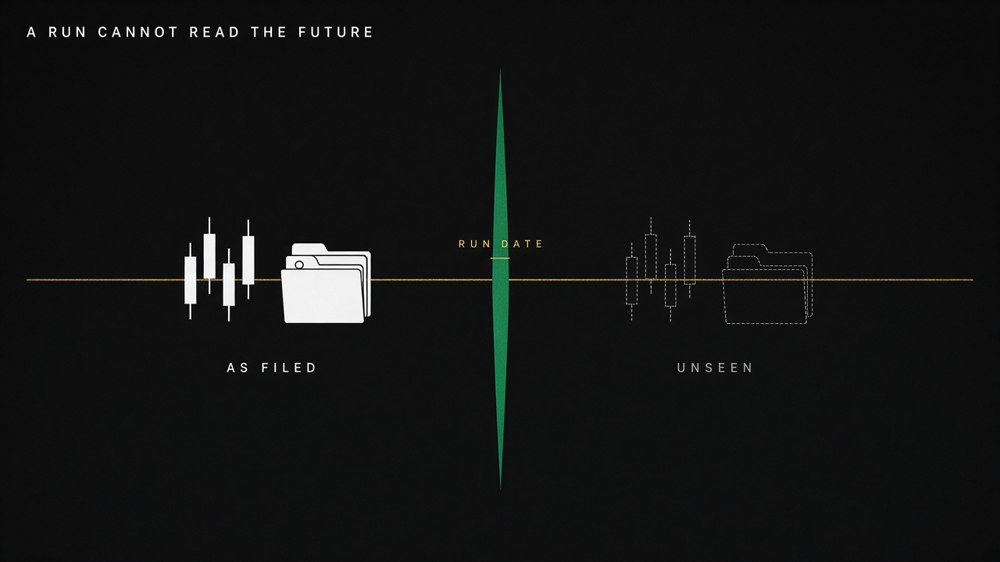
</p>
<p align="center"><sub>À gauche, as-filed. À droite, unseen. La lame est la date de run.</sub></p>

[Données](docs/donnees.md) · [architecture](docs/architecture.md)

---

## L’échelle

Le portfolio manager parle une langue à cinq paliers. S’il ne produit pas une ligne lisible, le système écrit **REVIEW** — ce n’est pas un Hold.

<p align="center">
  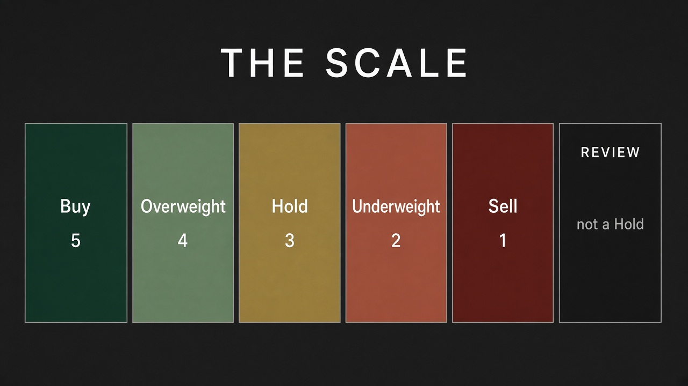
</p>
<p align="center"><sub>Buy · Overweight · Hold · Underweight · Sell. Review = illisible, pas neutre.</sub></p>

---

## Ce que ce fork ajoute

Le moteur, les vendors, les agents et le graphe restent ceux de Tauric (Apache 2.0, arXiv 2412.20138). Ce fork n’y touche pas. Il ajoute une **surface**, une **documentation**, un **kit**.

<p align="center">
  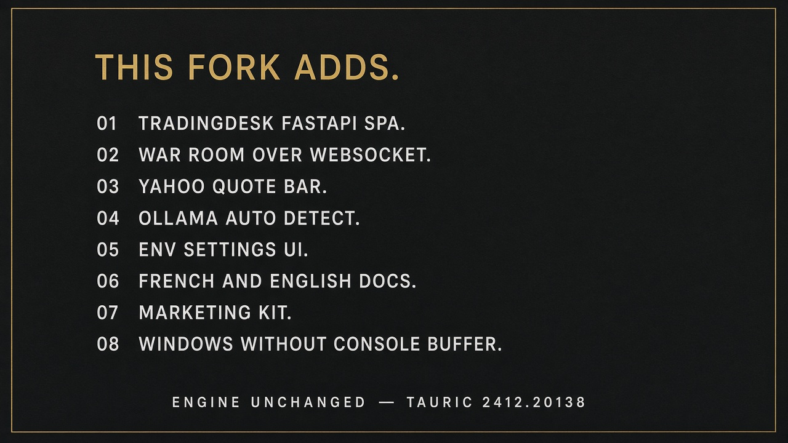
</p>

### Plateforme visuelle (TradingDesk)

| Ajout | Où | Pourquoi |
|---|---|---|
| Desk FastAPI + SPA | `webui/` · `python -m webui` · script `tradingdesk` | Voir la firme sans terminal |
| Extra pip `[web]` | `pyproject.toml` (`fastapi`, `uvicorn`) | Installer le desk sans alourdir le cœur |
| Salle des marchés live | WebSocket `/api/ws/runs/{id}` | Pousser le `MessageBuffer` carte par carte |
| Fil d’exécution | même `classify_message_type` que le CLI | Messages, tools, reasoning, identiques |
| Onglets de rapports | sections du tampon CLI | Le panneau Current Report, en markdown |
| Bandeau de décision | `run_rating` / `is_review` | Le footer « Recommendation », lisible |
| Barre de cotation | `GET /api/quote/{ticker}` (Yahoo `fast_info`) | Ancrer le desk sur un ticker |
| Archive HTML | page Rapports, `results_dir` | Relire `complete_report.html` |
| Page backtest | même `run_backtest` que le CLI | La commande grille, en formulaire |
| Réglages `.env` | `GET/POST /api/settings` | Écrire les clés `TRADINGAGENTS_*` sans éditeur |
| Détection Ollama | `catalog.py` si `:11434` répond | Présélectionner le local, lister `ollama list` |
| Checkpoints & portefeuille | cases du formulaire | Les flags `--checkpoint` / `--portfolio` |
| Binder `127.0.0.1` | défaut Uvicorn | Pas d’auth réseau : rester local |

### Transfert technique (ce qui n’est **pas** réimplémenté)

- `webui/runner.py` importe `MessageBuffer`, `classify_message_type`, `AnalystWallTimeTracker` depuis `cli.display`.
- La boucle est `graph.stream_run` — identique à `cli/run.py`.
- Les rapports, la mémoire, les logs d’état s’écrivent aux **mêmes chemins**.
- Le rating final passe par `tradingagents.agents.rating`, pas par un parseur UI.

### Documentation et produit

| Ajout | Fichiers |
|---|---|
| README français (landing) + anglais | `README.md`, `README.en.md` |
| Guides | `docs/` : démarrage, desk, CLI, architecture, config, fournisseurs, données, backtest, reproductibilité, FAQ, disclaimer |
| Kit marketing | `docs/marketing/` + `assets/marketing/` (hero, planches, OG, mark, captures) |
| GitHub | templates d’issues, `CONTRIBUTING.md`, `SECURITY.md` |
| Changelog de surface | section *Unreleased — TradingDesk* dans `CHANGELOG.md` |

### Windows

Le CLI Rich a besoin d’un screen buffer. Dans un terminal pipé (IDE, CI), il lève `NoConsoleScreenBufferError`. Le desk contourne ça : même run, navigateur, pas de console. Le CLI reste l’outil des jobs — il faut juste le lancer dans Windows Terminal, PowerShell ou cmd.

### Ce que le fork **ne** change pas

Les analystes, le débat, le trader, le risque, le PM, le point-in-time SEC, les 18 fournisseurs, Docker, le backtest moteur. Tout ça est upstream Tauric. Un rating desk et un rating CLI, à config égale, sortent de la **même** firme.

---

## Ce que le produit refuse

- **D’être un courtier.** Aucun ordre. [Disclaimer](docs/disclaimer.md).  
- **D’être bit-identique.** Deux LLM, deux textes. [Reproductibilité](docs/reproductibilite.md).  
- **De voir l’avenir.** C’est le contrat, pas une option.

---

## Python

```python
from tradingagents.graph.trading_graph import TradingAgentsGraph
from tradingagents.default_config import DEFAULT_CONFIG

ta = TradingAgentsGraph(debug=True, config=DEFAULT_CONFIG.copy())
state, decision = ta.propagate("NVDA", "2026-09-01")
print(decision)
ta.save_reports(state, "NVDA")
```

## Documentation

| | |
|---|---|
| [Démarrage](docs/demarrage.md) | Install, Ollama, première run |
| [TradingDesk](docs/tradingdesk.md) | Transfert CLI → salle, WebSocket, `.env` |
| [CLI](docs/cli.md) | Flags, Docker, Windows |
| [Architecture](docs/architecture.md) | Graphe, mémoire, checkpoints |
| [Configuration](docs/configuration.md) | `TRADINGAGENTS_*` |
| [Fournisseurs](docs/fournisseurs.md) | 18 backends, Ollama |
| [Données](docs/donnees.md) | Yahoo, SEC, FRED |
| [Backtest](docs/backtest.md) | Grille, alpha |
| [FAQ](docs/faq.md) | Pannes usuelles |

---

## Crédits

Moteur et papier : [Tauric Research](https://github.com/TauricResearch/TradingAgents) — Xiao, Sun, Luo, Wang.  
TradingDesk (transfert visuel du CLI, API, docs de ce fork) : ce dépôt.

```
@misc{xiao2025tradingagentsmultiagentsllmfinancial,
      title={TradingAgents: Multi-Agents LLM Financial Trading Framework},
      author={Yijia Xiao and Edward Sun and Di Luo and Wei Wang},
      year={2025},
      eprint={2412.20138},
      archivePrefix={arXiv},
      primaryClass={q-fin.TR},
      url={https://arxiv.org/abs/2412.20138},
}
```

[Contribuer](CONTRIBUTING.md) · [Changelog](CHANGELOG.md) · [Licence](LICENSE)
