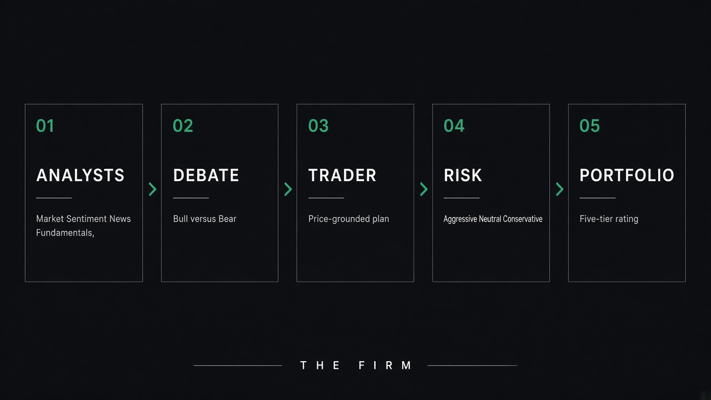

# Documentation TradingDesk

Le moteur est [TradingAgents](https://github.com/TauricResearch/TradingAgents). Ce fork y ajoute **TradingDesk**, le transfert visuel du CLI (même `MessageBuffer`, même graphe) — raconté dans le [README](../README.md#du-cli-à-la-salle).

  

## Parcours

1. [Démarrage](demarrage.md) — installer, Ollama ou une clé, première run  
2. [TradingDesk](tradingdesk.md) — le desk dans le navigateur  
3. [CLI](cli.md) — terminal, flags, Docker  
4. [Architecture](architecture.md) — qui parle, dans quel ordre, pourquoi  

## Référence

- [Configuration](configuration.md) — `.env` et `TRADINGAGENTS_*`  
- [Fournisseurs LLM](fournisseurs.md)  
- [Données et marchés](donnees.md)  
- [Backtest](backtest.md)  
- [Reproductibilité](reproductibilite.md)  
- [FAQ](faq.md)  
- [Disclaimer](disclaimer.md)  

## Produit

- [Positionnement](marketing/positionnement.md)  
- [Copie sociale et GitHub About](marketing/copie-sociale.md)  

## Papier

Xiao, Sun, Luo, Wang. *TradingAgents: Multi-Agents LLM Financial Trading Framework*. arXiv [2412.20138](https://arxiv.org/abs/2412.20138).
