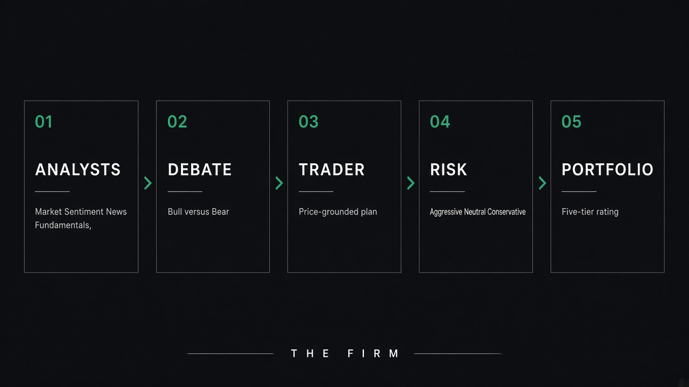

# Architecture

TradingAgents décompose une décision en une firme. LangGraph orchestre les nœuds. TradingDesk affiche le même flux.

<p align="center">
  
</p>

<p align="center">
  
</p>

## Équipes

### I. Analystes (parallèles)

| Clé | Agent | Travail |
|---|---|---|
| `market` | Market Analyst | Prix, indicateurs (MACD, RSI, …), snapshot vérifié |
| `social` | Sentiment Analyst | StockTwits, Reddit, news sociales. Option Jev (`TYPESAFE_API_KEY`) |
| `news` | News Analyst | Titres ticker + macro |
| `fundamentals` | Fundamentals Analyst | Comptes. SEC EDGAR pour les filers US, point-in-time |

Le crypto n’a pas de fundamentals analyst. Les analystes **partent ensemble** ; le débat n’attend plus une file.

### II. Recherche

Bull et bear s’écrivent l’un contre l’autre (`max_debate_rounds`). Le research manager tranche un plan.

### III. Trader

Compose le plan d’investissement. Les prix cités sont ancrés sur le snapshot, pas hallucinés.

### IV. Risque

Agressif, neutre, conservateur (`max_risk_discuss_rounds`).

### V. Portfolio manager

Décision finale. Échelle : **Buy, Overweight, Hold, Underweight, Sell**. Si aucun rating n’est lisible : **`REVIEW`** — ce n’est pas un Hold.

## Graphe

Classe : `tradingagents.graph.trading_graph.TradingAgentsGraph`.

- `propagate(ticker, date, asset_type, portfolio)` — run bloquante  
- `stream_run(...)` — paires `(messages, state)` utilisées par le CLI et le desk  
- `create_run_state` — identité d’instrument résolue une fois (`#814`)  
- `save_reports` — arbre markdown + HTML  
- `record_decision` — journal + mémoire  

Config : `tradingagents/default_config.py`. Le modèle **quick** sert analystes, chercheurs, débatteurs, trader. Le modèle **deep** sert les managers. Chaque palier peut avoir son propre provider (`quick_think_provider` / `deep_think_provider`).

## Point-in-time

Un run daté ne doit pas voir l’avenir :

- OHLCV et indicateurs bornés à la date  
- SEC EDGAR : figures **telles que déposées** ce jour-là (une restatement 2010 ne réécrit pas un run 2009)  
- News / social filtrés quand le vendor le permet (Alpha Vantage, etc.)  
- Le backtest n’injecte que des données publiées à la date de cellule  

Yahoo fundamentals datent la période, pas le dépôt : un run historique les refuse plutôt que de tricher.

## Mémoire

Toujours allumée. Chaque décision va dans `~/.tradingagents/memory/trading_memory.md`. Pendant que les analystes d’un run suivant travaillent, le nœud Memory Log **règle** les décisions dont la fenêtre de détention a coté (rendement, alpha vs benchmark régional, paragraphe de réflexion). Le portfolio manager relit les leçons du ticker — et des autres.

`ta.settle_all_pending()` règle sans analyser.

## Checkpoints

Opt-in (`--checkpoint` ou `TRADINGAGENTS_CHECKPOINT_ENABLED`). LangGraph sauve après chaque nœud. SQLite : `~/.tradingagents/cache/checkpoints/<TICKER>.db`. Un succès **efface** le checkpoint. La signature (analystes, profondeur, provider, modèle, asset, portefeuille) invalide une reprise trop différente.

## Portefeuille

Sans contexte, les agents parlent à un lecteur qui appliquera la note à **sa** position. Avec un `PortfolioContext` (cash, positions), trader / risque / PM dimensionnent contre le livre réel. Une liste `positions` vide = livre plat, ce qui n’est **pas** « pas de portefeuille ».

## Fichiers clés

```
tradingagents/graph/trading_graph.py
tradingagents/agents/analysts|researchers|trader|risk_mgmt|managers
tradingagents/dataflows/          vendors + contrat de date
cli/run.py                        boucle live CLI
webui/runner.py                   même boucle, événements UI
```
