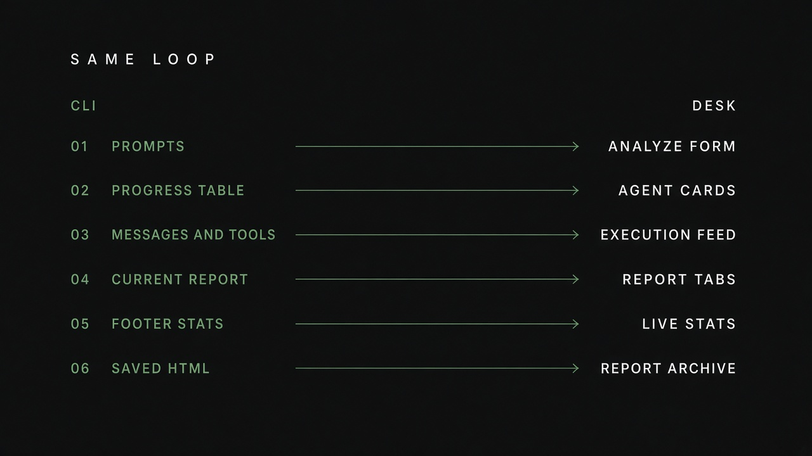
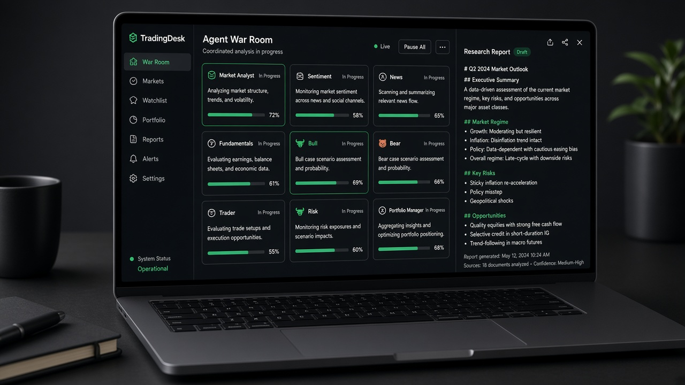

# TradingDesk

TradingDesk est le **transfert visuel du CLI**, pas un second moteur. `cli/display.py` dessine déjà une salle (`Rich.Live` : table d’agents, journal, rapport, stats). `webui/runner.py` rejoue la boucle de `cli/run.py` (stream LangGraph, `MessageBuffer`, `classify_message_type`, `save_reports`) et pousse ce tampon dans le navigateur.

<p align="center">
  
</p>
<p align="center"><sub>Six panneaux CLI, six surfaces desk. Détail dans le <a href="../README.md">README</a>.</sub></p>

<p align="center">
  
</p>

## Lancer

```bash
pip install ".[web]"
python -m webui                 # http://127.0.0.1:8787
python -m webui --port 9000
python -m webui --no-browser
```

Commande installée : `tradingdesk` (après `pip install ".[web]"`).

## Pages

| Page | Rôle |
|---|---|
| **Desk** | Cotation Yahoo, runs live, dernières décisions disque |
| **Nouvelle analyse** | Ticker, date, analystes, profondeur, fournisseur, modèles, portefeuille optionnel |
| **Salle des marchés** | Cartes d’agents, fil d’exécution, onglets de rapports, rating final |
| **Rapports** | Archive `~/.tradingagents/logs` + HTML |
| **Backtest** | Grille ticker × dates, même `run_backtest` que le CLI |
| **Réglages** | Écriture ciblée dans `.env` (clés et `TRADINGAGENTS_*`) |

Si Ollama répond sur `localhost:11434`, le formulaire présélectionne **Ollama** et liste les modèles `ollama list`.

## Contrat API

Le front est une SPA statique (`webui/static`). L’API :

| Méthode | Chemin | |
|---|---|---|
| `GET` | `/api/meta` | providers, modèles, analystes, défauts |
| `GET` | `/api/quote/{ticker}` | `yfinance.fast_info` |
| `POST` | `/api/runs` | démarre une analyse, `{id, status}` |
| `WS` | `/api/ws/runs/{id}` | événements `run_started`, `message`, `tool`, `report`, `snapshot`, `run_completed`, `run_error` |
| `GET` | `/api/runs` | jobs mémoire + scans disque |
| `GET` | `/api/history/{ticker}/{date}` | état JSON + markdown |
| `POST` | `/api/backtests` | sweep |
| `GET/POST` | `/api/settings` | `.env` |

Les chemins de rapports sont restreints à `results_dir`.

## Correspondance CLI

Le README raconte le transfert avec les captures réelles (`assets/cli/cli_init.png`, `cli_news.png`, `cli_transaction.png`). Ici, la table courte :

| CLI (`Rich.Live`) | Desk |
|---|---|
| Prompts questionary | formulaire **Nouvelle analyse** |
| Table Progress (Team / Agent / Status) | cartes d’agents, salle des marchés |
| Messages & Tools | fil d’exécution (WebSocket) |
| Current Report | onglets de rapports |
| Footer tool / LLM / reports | stats live |
| `complete_report.html` | iframe Rapports |
| `--checkpoint` | case à cocher |
| `--portfolio` | bloc cash / position |
| `tradingagents backtest` | page Backtest |

Une run desk **écrit les mêmes fichiers** qu’une run CLI : mémoire, logs d’état, arbre de rapports. Les agents, le graphe et le rating ne sont pas réimplémentés.

## Limites actuelles

- Un job vit en mémoire processus : redémarrer Uvicorn perd le live (pas l’archive disque).  
- Pas d’auth réseau : binder `127.0.0.1` par défaut.  
- Le CLI Windows refuse un terminal sans console buffer ; le desk n’a pas ce problème.

## Architecture des fichiers

```
webui/
  app.py          FastAPI
  runner.py       stream = cli/run.py
  catalog.py      meta UI
  history.py      scan results_dir
  static/         SPA
```
